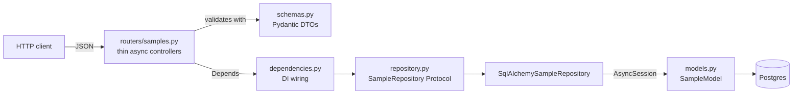
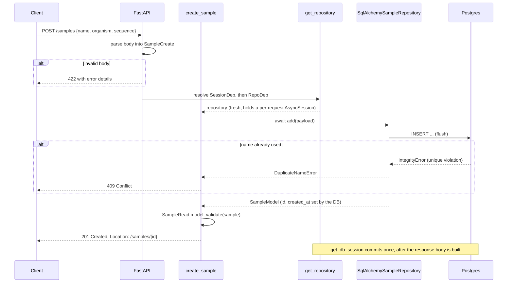
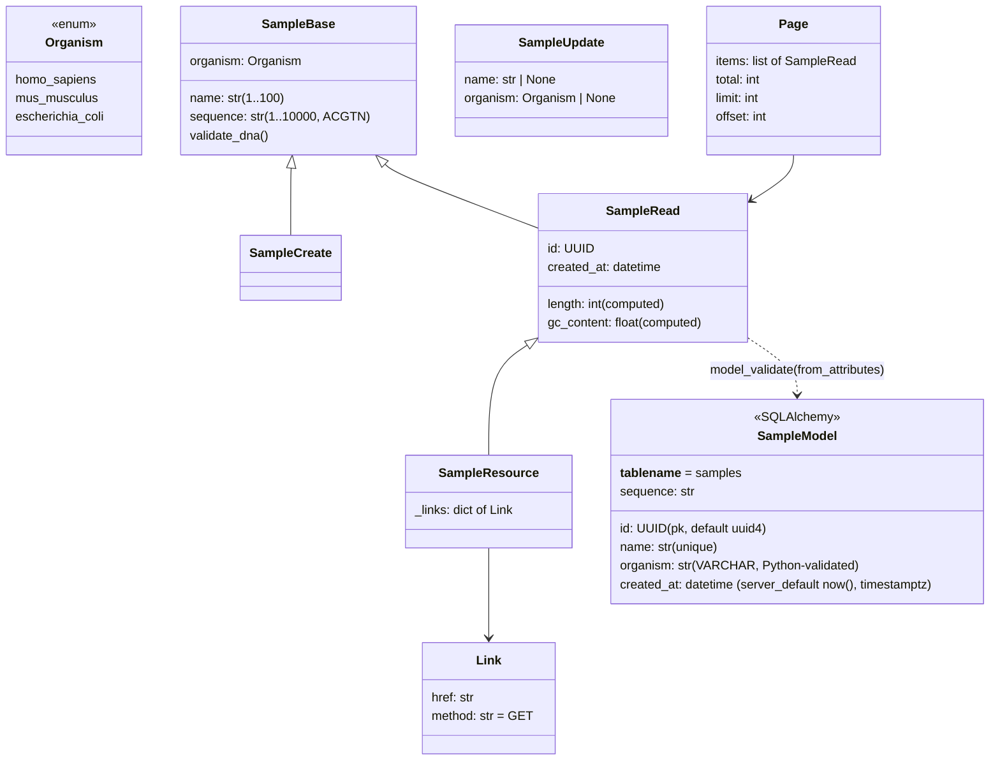

# Architecture: Lab Sample Registry API

A small, production-style REST service used to teach API design. It stores DNA samples
(name, organism, sequence) and exposes CRUD over HTTP, backed by async SQLAlchemy 2.0 + Postgres.

## 1. Tech stack

| Concern | Tool | Why |
|---|---|---|
| Web framework | FastAPI | Type hints drive routing, validation and OpenAPI docs (`/docs`) |
| Data contract | Pydantic v2 | Validation, normalization, computed fields, JSON serialization |
| ASGI server | Uvicorn | Runs the app: `uv run uvicorn app.main:app --reload` |
| Database | Postgres | Durable storage; runs locally via `docker-compose.yml` |
| ORM | SQLAlchemy 2.0 (async, `asyncpg` driver) | Declarative models, async `Session`, unit-of-work per request |
| Migrations | Alembic (async template) | Autogenerated revisions from `Base.metadata` |
| Config | pydantic-settings | 12-factor: `DATABASE_URL` etc. from env / `.env` |
| HTTP client | httpx | Used by `client.py`, `fetch_uniprot.py` and the async test client |
| Tests | pytest, pytest-asyncio | In-process async tests, no running server needed |
| Quality | ruff, mypy (strict + pydantic plugin) | Lint, format, static types |
| Packaging | uv (`pyproject.toml`, `uv.lock`) | Reproducible environment, one command setup |

Python 3.10+ is required, so the code avoids `datetime.UTC`, `enum.StrEnum` and `typing.Self`.

## 2. Layers



Each layer has one job and only talks to its neighbour:

| File | Responsibility | Must not |
|---|---|---|
| `app/schemas.py` | API contract: what clients may send and what they get back | know about storage or HTTP |
| `app/routers/samples.py` | Map HTTP (paths, status codes, headers) to repository calls | import storage code |
| `app/dependencies.py` | Build and hand out the repository; shared lookups such as 404 | contain business rules |
| `app/repository.py` | The only code that reads or writes storage (owns the `Session`) | import FastAPI |
| `app/models.py` | SQLAlchemy table metadata (shape only, like `schemas.py` for HTTP) | open a `Session` or run a query |
| `app/db.py` | Engine/session lifecycle: lifespan, per-request session | contain business rules |
| `app/config.py` | Env-driven settings (`DATABASE_URL`, ...) | know about FastAPI or storage |
| `app/main.py` | Assemble the app from routers, wire the db lifespan | hold endpoint logic |

Because routers depend on the `SampleRepository` Protocol, not on a concrete class, the
storage engine is a detail that can change behind the interface.

### Design patterns in the code

| Pattern | Where | What it buys |
|---|---|---|
| Application Factory | `create_app()` in `app/main.py` | Tests build a fresh app per test |
| DTO | `SampleCreate`, `SampleUpdate`, `SampleRead` | Clients cannot set server-owned fields |
| Repository | `SampleRepository` + `InMemorySampleRepository` + `SqlAlchemySampleRepository` | Storage swap without router changes |
| Dependency Injection | `RepoDep`, `SampleDep`, `SessionDep` via `Depends` | Routers receive what they need; tests override it |
| Unit of work | `get_db_session` (per-request `AsyncSession`, commit/rollback in `finally`) | One transaction per request, not a shared singleton |
| Thin controller | each route is a few lines, `async def` | HTTP concerns separate from data concerns |

## 3. Request lifecycle

Example: `POST /samples`.



Steps worth noticing:

1. **Validation happens before your code runs.** If the body does not match `SampleCreate`,
   FastAPI returns 422 and the route function is never called.
2. **The session is scoped to one request.** `SessionDep` (`get_db_session`) opens an
   `AsyncSession` per request and commits it in a `finally` block once the handler returns;
   `get_repository()` builds a fresh `SqlAlchemySampleRepository` around that session, so there
   is no shared, process-wide store.
3. **Domain errors become HTTP errors in the router.** The repository catches Postgres's
   `IntegrityError` on the unique `name` constraint and raises a plain `DuplicateNameError`;
   only the router knows that this means 409.
4. **Output goes through a response model.** `SampleRead.model_validate(sample)` reads the
   ORM instance's attributes (`from_attributes=True`) and adds computed fields.

For routes with `{sample_id}`, the `SampleDep` dependency (`get_sample_or_404`) parses the
UUID, loads the sample and raises 404 if it does not exist. The route body only ever sees a
real `Sample`.

## 4. Data models

There are two kinds of model, and keeping them apart is the main lesson of the module.

- **DTOs (Pydantic, `schemas.py`)**: the public contract over the wire.
- **Persistence model (SQLAlchemy, `models.py`)**: what Postgres actually stores. A structural
  `Sample` Protocol in `repository.py` describes the shape any repository hands back (either a
  `SampleModel` row or, for the DB-free `InMemorySampleRepository`, an `InMemorySample`
  dataclass), so the router code and `SampleRead.model_validate(..., from_attributes=True)` never
  need to know which one they got.



| Model | Used for | Key points |
|---|---|---|
| `Organism` | Allowed species | `str` Enum, so JSON values are plain strings; anything else is 422 |
| `SampleBase` | Shared fields | `validate_dna` runs before type checks: strips, uppercases, allows only `A C G T N` |
| `SampleCreate` | `POST` body | No `id` or `created_at`: the server owns them |
| `SampleUpdate` | `PATCH` body | Every field optional; `sequence` is deliberately not editable |
| `SampleRead` | Responses | Adds `id`, `created_at` and computed `length`, `gc_content` |
| `SampleResource` | `GET /samples/{id}` | Adds hypermedia links, serialized as `_links` |
| `Page` | `GET /samples` | Envelope with `items`, `total`, `limit`, `offset` |
| `SampleModel` | Storage (`app/models.py`) | Declarative model; `id`/`created_at` are server-generated, `name` has a unique constraint |

The `organism` column stores the enum's *value* (e.g. `"homo_sapiens"`), not its member name,
via `values_callable` on the SQLAlchemy `Enum` type, and is a plain `VARCHAR` (`native_enum=False`)
rather than a native Postgres `ENUM` - adding a new organism later is then a normal migration
instead of an `ALTER TYPE ... ADD VALUE`.

Why separate input and output models? If one model served both directions, a client could
send its own `id` or `created_at`, and derived values like `gc_content` would have to be
stored and kept in sync. Splitting them makes the contract explicit and safe.

Example: sending `"sequence": "atgcgc"` stores `ATGCGC` and returns `length: 6`,
`gc_content: 0.6667`.

## 5. REST API design

| Method | Path | Success | Errors |
|---|---|---|---|
| GET | `/samples?organism=&limit=&offset=` | 200 `Page` | 422 |
| POST | `/samples` | 201 + `Location` header | 409, 422 |
| GET | `/samples/{id}` | 200 + `_links` | 404, 422 |
| PATCH | `/samples/{id}` | 200 | 404, 422 |
| DELETE | `/samples/{id}` | 204, empty body | 404 |
| GET | `/health` | 200 `{"status": "ok"}` | |

Design decisions:

- **Nouns in paths, verbs in methods.** One resource (`/samples`), one router.
- **Status codes carry meaning.** 201 plus `Location` tells the client where the new resource
  lives; 204 means success with nothing to return; 409 means the request conflicts with
  current state (duplicate name); 422 means the input is malformed.
- **Filtering and pagination via query parameters.** `limit` is 1..100 (default 20), `offset`
  is 0 or more. `total` lets clients compute the number of pages.
- **PATCH is a partial update.** The repository applies only fields the client actually sent
  (`model_dump(exclude_unset=True)`), so omitted fields are left untouched.
- **Richardson Maturity Level 3 (HATEOAS).** `GET /samples/{id}` returns `_links` with
  `self`, `update`, `delete` and `collection`. Clients follow links instead of building URLs.
  URLs are generated with `request.url_for`, so they stay correct if prefixes change.

## 6. Testing

`tests/test_samples.py` uses an `httpx.AsyncClient` over `ASGITransport`, which calls the app
in process against a real test Postgres instance (`test_db` in `docker-compose.yml`): no
server, no network, but real SQL and real constraints.

```python
app = create_app()
app.dependency_overrides[get_repository] = lambda: sample_repository
```

`sample_repository` (from `tests/conftest.py`) wraps each test in its own database transaction:
it opens a connection, begins an outer transaction plus a `SAVEPOINT`, and hands the session to
an `AsyncSession(bind=conn, join_transaction_mode="create_savepoint")`. Nothing the test does is
ever committed - the fixture rolls the transaction back on teardown - so tests never share state
and never need manual cleanup, exactly like the old `InMemorySampleRepository()`-per-test setup,
but against the real database dialect.

Coverage includes the happy path and every documented error: 201 + `Location`, 422 for bad
sequence, organism and name, 409 on duplicates (a real unique-constraint violation, not a
linear scan), the full CRUD lifecycle, filtering + pagination, 404 on unknown id, and following
a hypermedia link.

Conventions live in `tests/CLAUDE.md`. End-to-end tests with Robot Framework against a
running server are planned in `e2e/`.

## 7. Clients

- `client.py`: consumes this API with `httpx` exactly as another service would (create, list,
  rename, trigger a validation error, delete). Start the server first.
- `fetch_uniprot.py`: consumes a real public bio API (UniProt) and maps its JSON to a small
  `TypedDict`. Shows the consumer side: timeouts and `raise_for_status()`.
- HTTPie from the terminal: see [docs/httpie.md](docs/httpie.md) for testing every endpoint
  without Swagger UI.

## 8. Tooling and quality gate

`uv run python scripts/check.py` runs, stopping at the first failure:

1. **dashes**: no em or en dash characters in project text files (house style)
2. **pytest**
3. **ruff** lint
4. **mypy** strict on `app/`

The summary is short; full output goes to `.claude/logs/check.log`.

`.claude/settings.json` wires Claude Code hooks: `uv sync` on session start, a guard that
forces `uv run` instead of bare `pip`/`python`, auto format + lint and a dash check after
every edit, and a check run when a session stops.

## 9. Limitations and next steps

`InMemorySampleRepository` is kept in `app/repository.py` as a fast, DB-free implementation of
the same `SampleRepository` Protocol (useful for quick experiments), but it is not wired into
the app by default and shares the old limitations: data lost on restart, no cross-process
sharing, no real locking. The default `get_repository()` now returns `SqlAlchemySampleRepository`.

Exercises:

1. Add `GET /samples/{id}/reverse-complement`.
2. Add an `X-API-Key` header dependency that returns 401 when missing.
3. Add a second Alembic revision (e.g. an index, or a new column) and confirm `alembic upgrade
   head` / `alembic downgrade -1` both work cleanly.

## 10. Run it

```bash
cp .env.example .env                  # DATABASE_URL / TEST_DATABASE_URL
docker compose up -d db test_db       # dev + test Postgres
uv sync                               # create .venv and install everything
uv run alembic upgrade head           # create the schema
uv run uvicorn app.main:app --reload  # http://127.0.0.1:8000/docs
uv run python client.py               # in a second terminal
uv run pytest                         # tests, run against test_db (Postgres)
uv run python scripts/check.py        # tests + lint + types
```
